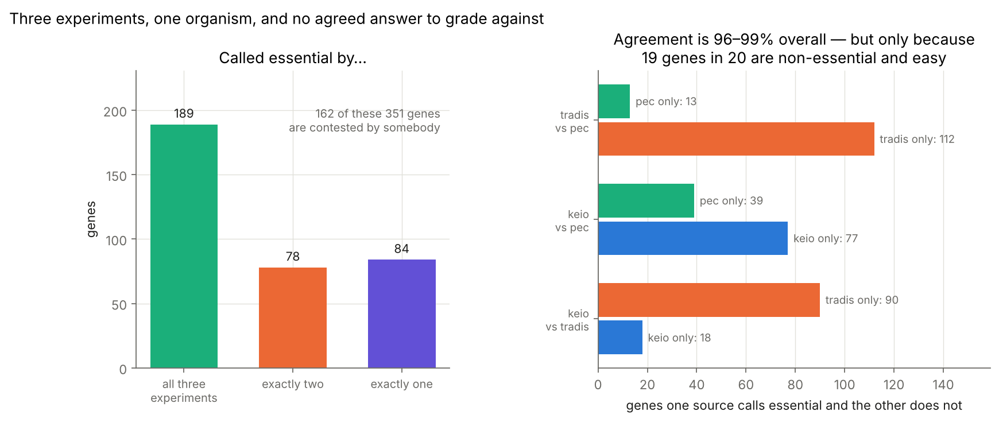
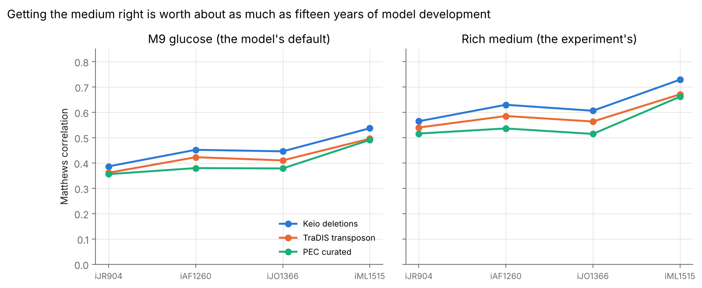
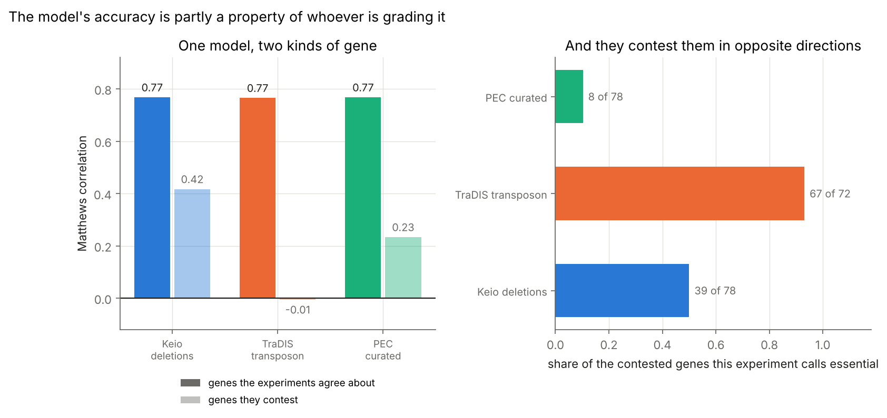
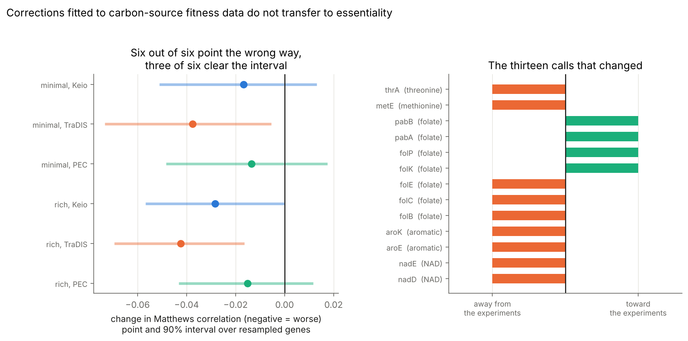

# E. coli essentiality benchmarks: what is the model being graded against?

[](https://github.com/jackcormacwright1/ecoli-essentiality-benchmarks/actions/workflows/tests.yml)

A genome-scale metabolic model's gene essentiality accuracy is always quoted against one experiment.
There is more than one experiment. They were done on the same organism, mostly the same strain, by
different labs with different technologies, and they disagree about roughly half the genes they call
essential.

This repository grades four generations of *E. coli* model against three of those experiments at once,
and then uses the disagreement as the measurement rather than averaging it away. It ends with an
out-of-sample test of a published set of model corrections, which fails.



## Four findings

**1. There is no single answer to grade against.** Of the 351 genes called essential by at least one of
the three experiments where all three have an opinion, only 189 are called essential by all three. 162
are contested. Pairwise agreement looks reassuring at 96–99%, but that number is carried entirely by the
19 genes in 20 that everyone agrees are dispensable; every disagreement is about an essential gene, which
is the only class anybody cares about.

**2. The medium matters as much as fifteen years of model development.** iML1515 scores MCC 0.537
against the Keio collection on its own default M9 glucose, and 0.728 on a rich medium closer to the one
the Keio collection was actually built in. That 0.19 gap is slightly larger than the 0.15 gained by going
from iJR904 (2003) to iML1515 (2017). A quoted accuracy figure without a stated medium is not a
measurement of the model.



**3. The model's apparent accuracy is partly a property of whoever is grading it.** On the genes the
experiments agree about, iML1515 scores MCC 0.766–0.768 — effectively identical whichever experiment you
pick, because on those genes the experiments *are* the same labels. On the genes they contest it scores
0.417, 0.234 and −0.006. And they contest them in opposite directions: of 72–78 contested genes, TraDIS
calls 67 essential, Keio calls 39, PEC calls 8. So the model looks like it is under-calling essentiality
if you grade it against TraDIS and over-calling it if you grade it against PEC — from the same
predictions.

70% of the genes iML1515 gets wrong against at least one experiment are genes the experiments themselves
disagree about.



**4. A published set of corrections does not transfer.** The corrections in `iML1515_corrected` were
derived against RB-TnSeq carbon-source fitness data. None of the three essentiality experiments here was
used to make them, so grading the corrected model against them is an out-of-sample test by construction.
It comes out negative in all six medium × experiment combinations:

| Medium | Experiment | MCC before | MCC after | Δ MCC | 90% interval |
|---|---|---|---|---|---|
| minimal | Keio | 0.537 | 0.519 | −0.018 | −0.051 to +0.013 |
| minimal | TraDIS | 0.495 | 0.458 | **−0.038** | −0.073 to −0.006 |
| minimal | PEC | 0.491 | 0.477 | −0.014 | −0.048 to +0.018 |
| rich | Keio | 0.728 | 0.700 | **−0.029** | −0.057 to −0.000 |
| rich | TraDIS | 0.670 | 0.629 | **−0.042** | −0.070 to −0.016 |
| rich | PEC | 0.661 | 0.646 | −0.015 | −0.043 to +0.012 |

Three of the six clear a 90% bootstrap interval on their own; all six point the same way. The six tests
are not independent — they share a model and overlapping gene sets — so this is weaker than six
independent replications, and the intervals are narrower than the truth because genes within a pathway do
not vary independently either. The honest summary is a consistent small loss, not a dramatic one.



### Why it fails, and why that was predictable

Only thirteen gene calls change, and they are not scattered. The corrections are small and readable —
two added reactions, nine substantive gene-rule changes (plus 28 cosmetic re-bracketings and 35 bound
changes) — and between them they account for all thirteen, in two opposite directions.

**Two added exchange reactions make nine genes dispensable.** `EX_nad_c` and `EX_thf_c` are *intracellular*
exchanges: they let the model draw NAD and tetrahydrofolate from nowhere. That turns off the need for
folate biosynthesis (*folB*, *folC*, *folE*, *folK*, *folP*, *pabA*, *pabB*) and NAD biosynthesis
(*nadD*, *nadE*). These are not biochemical corrections — they model **carry-over**, the cofactor a mutant
inherits from its parent and from the pooled culture, which keeps a transposon mutant alive long enough to
be counted. That is a real effect in a pooled fitness assay and the right fix there. It is the wrong fix
for a deletion collection, where a mutant has to form a colony from one cell. *nadD* and *nadE* are called
essential by all three experiments here; the corrected model calls them dispensable.

**Nine tightened gene rules make four genes essential.** Each one drops an isozyme from an `or` rule,
leaving a single gene carrying the reaction:

| Reaction | Isozyme dropped | Gene left alone | What the experiments say about it |
|---|---|---|---|
| SHK3Dr | *b1692* | *aroE* | non-essential in all three |
| SHKK | *aroL* | *aroK* | non-essential in all three |
| ASPK, HSDy | *metL*, *lysC* | *thrA* | non-essential in all three |
| METS | *metH* | *metE* | non-essential in all three |

Dropping *metH* from methionine synthase is true when B12 is absent. Dropping *aroL* from shikimate kinase
is true when *aroL* is not expressed. These are conditional facts about the assay the corrections were
fitted to, promoted into unconditional structure in the model, and all four produce false positives here.

So this is not a case of corrections being wrong. It is a case of corrections encoding properties of one
assay, and being inherited by everybody who downloads the corrected model for a different purpose.

## An honest-reporting problem this surfaced

Under minimal medium the corrections **reduce the raw error count** (Keio: 137 → 130) while reducing MCC.
The two measures disagree, and a write-up that quoted whichever one suited would be able to call this
result either way.

The reason is that counting errors prices a lost true positive and a lost false positive the same.
They are not the same. Essential genes are about 8% of the graded set, so a true positive is scarce and a
false alarm is cheap. Against Keio on minimal medium the corrections lose 8 true positives to shed 15
false positives: the error count falls by 7, recall falls from 0.742 to 0.675, and the model gets worse at
the only thing anyone wants it for. `results/reconcile.csv` reports both sides of that trade for all six
tests so the arithmetic can be checked rather than taken on trust.

## The experiments

| | What it measures | How it fails |
|---|---|---|
| **Keio** (Baba et al. 2006) | a gene is essential if no verified in-frame deletion mutant could be made | misses genes whose mutants survive only with a suppressor; inherits library construction errors |
| **TraDIS** (Goodall et al. 2018) | essentiality inferred from the gap in dense transposon insertions | miscalls genes with a short essential region, and genes upstream of an essential one whose promoter the insertion kills |
| **PEC** | curated call from the published literature | inherits whatever the literature inherited; not an independent experiment so much as an informed summary |

A fourth source, an earlier Tn5 screen collated in the Keio supplement, is loaded but kept out of the
headline comparison: it never calls a single gene essential, so it cannot disagree with anything. A fifth,
the classical genetic literature's call, is loaded for the same reason and used the same way. Both are in
`results/consensus.csv` for anyone who wants them.

## What's here

| | |
|---|---|
| `src/eeb/essentiality.py` | the five published opinions, mapped onto one b-number index, with NA kept as a third state |
| `src/eeb/model.py` | medium specification, single-gene deletion scans, the confusion matrix |
| `src/eeb/transfer.py` | does a correction transfer? gene-level changes, bootstrap, and the error-count reconciliation |
| `scripts/01_fetch.py` | checks every input is present and says where each one comes from |
| `scripts/02_grade.py` | every number quoted above |
| `scripts/03_figures.py` | every chart |
| `tests/test_core.py` | 20 tests, including the four findings as regression tests |
| `docs/METHODOLOGY.md` | the choices, the arithmetic, and what this design cannot tell you |

## Running it

The three experimental tables are committed. The SBML models are not — they are ~50MB and freely
available from BiGG.

```bash
pip install -e ".[dev]"
PYTHONPATH=src python scripts/01_fetch.py --download   # the four BiGG models
PYTHONPATH=src python scripts/02_grade.py              # results/*.csv  (a few minutes)
PYTHONPATH=src python scripts/03_figures.py            # results/*.png
pytest
```

`iML1515_corrected` is a supplementary file of the Bernstein paper rather than a BiGG model, so
`01_fetch.py` prints where to get it rather than downloading it.

**One thing to know if you reuse this code:** `iML1515_model_adjusted_all_corrections.xml` is infeasible
as distributed. It arrives with 24 of its uptake reactions closed, including glucose, and three left open
— the authors saved it part-way through an analysis that set the medium itself. Run a deletion scan on it
as-is and every gene comes back dispensable, which looks like a result. `set_medium()` puts all five
models on one M9 glucose base plus whatever each author deliberately left open, and `predict_essential()`
raises rather than scoring a model that does not grow.

## Sources

- Baba et al. (2006), [*Construction of Escherichia coli K-12 in-frame, single-gene knockout mutants: the
  Keio collection*](https://www.embopress.org/doi/full/10.1038/msb4100050), Molecular Systems Biology.
- Goodall et al. (2018), [*The Essential Genome of Escherichia coli
  K-12*](https://journals.asm.org/doi/10.1128/mBio.02096-17), mBio.
- Monk et al. (2017), [*iML1515, a knowledgebase that computes Escherichia coli
  traits*](https://www.nature.com/articles/nbt.3956), Nature Biotechnology.
- Bernstein et al. (2023), [*Evaluating E. coli genome-scale metabolic model accuracy with
  high-throughput mutant fitness data*](https://www.embopress.org/doi/full/10.15252/msb.202211566),
  Molecular Systems Biology.
- [PEC: Profiling of the E. coli Chromosome](https://shigen.nig.ac.jp/ecoli/pec/).
- [BiGG Models](http://bigg.ucsd.edu/).
